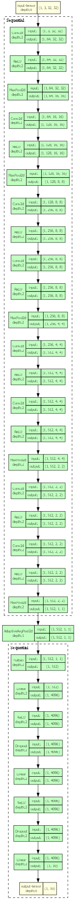

# CS4287 – Neural Networks Assignment01

## Project Overview

This repository contains Neural Networks assignment, which focuses on image classification using Convolutional Neural Networks (CNNs).

The project explores a VGG-style CNN architecture using PyTorch and the CIFAR-10 dataset. The aim is to train and evaluate a neural network that can classify images into different categories.

## Dataset

The project uses the CIFAR-10 dataset, which contains 60,000 colour images divided into 10 classes.

- Training images: 50,000
- Testing images: 10,000
- Image size: 32 × 32 pixels
- Number of classes: 10

## Model Architecture

The project uses a VGG-style Convolutional Neural Network.

The architecture includes:
- Convolutional layers for feature extraction
- ReLU activation functions
- Pooling layers for reducing image dimensions
- Fully connected layers for classification

The repository also includes a diagram of the VGG11 architecture.

## Technologies Used

- Python
- PyTorch
- Jupyter Notebook
- CIFAR-10 Dataset

## Repository Structure

- `CS4287-Assign2-23362995-23365021-23378247.ipynb` – Main notebook containing the project implementation.
- `cnn_results/` – Folder containing CNN experiment results.
- `vgg11_architecture.png` – Diagram of the VGG11 architecture.
- `README.md` – Project documentation.

## Running the Project

1. Clone the repository:

   git clone https://github.com/Amilkamija/CS4287-Assignment01.git

2. Open the project in Jupyter Notebook or VS Code.

3. Install the required Python libraries.

4. Open the main `.ipynb` notebook.

5. Run the notebook cells in order to execute the experiments.

## Results

The results of the CNN experiments are stored in the `cnn_results` folder.

The notebook contains the implementation and evaluation of the neural network.

## Authors
Amelia Polak,Mateusz Przywozny,Jakub Bolka

